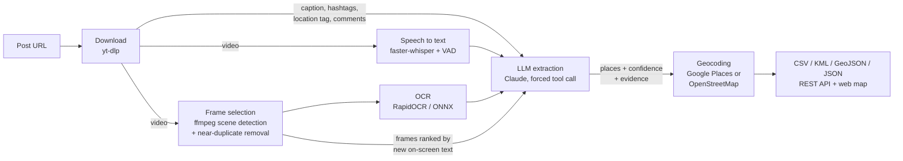

# reel2map

[](https://github.com/MayaLandman/reel-2-map/actions/workflows/ci.yml)


**Turn TikTok, Instagram Reels and YouTube Shorts recommendation videos into a map of real places.**

"10 places you can't miss in Rome" videos are great for discovering places but hard to act on. The names fly by as text overlays, get mentioned out loud, or show up only in the comments. reel2map scrapes the whole post: it downloads the video, transcribes the speech, reads the on-screen text, and looks at the frames. Then it uses an LLM to work out every place that's recommended and finds each one on the map. You get CSV, KML or GeoJSON files that you can import into Google My Maps or Google Earth.

Example (illustrative output):

```console
$ reel2map extract https://www.tiktok.com/@someone/video/7701458645501988126 -o rome.csv

                        8 must-try spots in central Rome
 #  Place                 Category     City   Conf.  Found on map                Why
 1  Roscioli Salumeria    restaurant   Rome   0.97   Via dei Giubbonari 21, …    Carbonara and burrata…
 2  Pizzarium Bonci       pizzeria     Rome   0.95   Via della Meloria 43, …     Pizza by the slice…
 …
download: 6.2s  transcribe + frames + ocr: 21.4s  extract: 14.9s  geocode: 8.1s
saved 8 places to rome.csv
```

## How it works



| Stage | What it does | Why it's built this way |
|---|---|---|
| **Download** | `yt-dlp` fetches the video or photo carousel plus its metadata: caption, hashtags, location tag and the top comments (pinned first, then most liked). | yt-dlp supports more than 1,800 sites and gets updated when platforms change. TikTok photo posts and Instagram carousels need special handling, so there are fallbacks for those. |
| **Speech** | ffmpeg extracts 16 kHz mono audio, then `faster-whisper` transcribes it with timestamps. | Many creators say the place name out loud and never write it. Voice activity detection skips music-only sections, which is where Whisper tends to invent text. |
| **Frames** | ffmpeg picks a frame whenever the scene changes, and at least one every N seconds. Near-duplicates are then removed by comparing small grayscale thumbnails and counting the pixels that changed strongly. | These videos are usually "one place per shot". The goal is one good frame per shot, not hundreds of nearly identical ones. Counting strongly changed pixels, instead of averaging the difference, keeps frames where only the title overlay changed. |
| **OCR** | RapidOCR (PaddleOCR models running on ONNX Runtime) reads the text overlays on each kept frame. | Runs on CPU and needs no system packages. The OCR text also decides which frames are worth sending to the LLM as images (*novelty ranking*). |
| **Extraction** | Claude gets all the text evidence plus the selected frames, and must reply by calling a `report_places` tool with a JSON schema. Long videos are split into consecutive slices that are processed in parallel and then merged. | A forced tool call guarantees structured output. Cross-checking speech, OCR and images corrects errors that each source makes on its own. Each place records which sources support it and a confidence score. |
| **Geocoding** | Google Places API (New) Text Search if a key is set, otherwise OpenStreetMap Nominatim. Queries start specific and get looser (name + street + city, then name + city, then name + country). | Both backends share the same interface. Nominatim works for free with no key, and the client respects its 1 request/second usage policy. |

Optional stages fail gracefully. If Whisper or OCR isn't installed, or transcription fails, the result gets a warning instead of the whole run crashing.

## Quick start

Requirements: Python 3.11+ and [ffmpeg](https://ffmpeg.org/download.html) on your `PATH`.

```bash
git clone https://github.com/MayaLandman/reel-2-map.git
cd reel-2-map
python -m venv .venv && source .venv/bin/activate
pip install -e ".[all]"            # core + Whisper + OCR

cp .env.example .env               # then add your ANTHROPIC_API_KEY
```

### Command line

```bash
# one post, table in the terminal, results to CSV (import into Google My Maps)
reel2map extract "https://www.tiktok.com/@user/video/123" -o places.csv

# a file with one URL per line, KML for Google Earth, explanations in Hebrew
reel2map extract urls.txt -o trip.kml --lang he

# Instagram usually needs a logged-in session
reel2map extract "https://www.instagram.com/reel/abc/" --cookies-from-browser chrome

# faster and cheaper: skip speech, keep the media to inspect it
reel2map extract URL --no-transcribe --keep-media ./debug
```

### Web app and REST API

```bash
reel2map serve            # http://127.0.0.1:8000, API docs at /docs
```

Paste a link, and the places show up on a Leaflet map as they're found, with download buttons for each format.

```bash
curl -X POST localhost:8000/api/jobs -H 'Content-Type: application/json' \
     -d '{"url": "https://www.tiktok.com/@user/video/123", "language": "en"}'
# {"id": "3f2a9c1b7d4e", "status": "queued", ...}

curl localhost:8000/api/jobs/3f2a9c1b7d4e                      # status, current stage, result
curl localhost:8000/api/jobs/3f2a9c1b7d4e/export?format=kml    # csv | kml | geojson | json
```

### Docker

```bash
docker build -t reel2map .
docker run --rm -p 8000:8000 --env-file .env reel2map
```

## Configuration

All settings are environment variables, which can also go in `.env`:

| Variable | Default | |
|---|---|---|
| `ANTHROPIC_API_KEY` | none | Required for extraction |
| `GOOGLE_MAPS_API_KEY` | none | Optional. Uses Google Places instead of OpenStreetMap |
| `REEL2MAP_MODEL` | `claude-sonnet-5-5` | LLM used for extraction |
| `REEL2MAP_OUTPUT_LANGUAGE` | `en` | Language of the "why" text |
| `REEL2MAP_WHISPER_MODEL` | `small` | `tiny` … `large-v3`: trades speed for accuracy |
| `REEL2MAP_MAX_IMAGES` | `20` | Frames sent to the LLM per call |
| `REEL2MAP_MAX_FRAMES` | `60` | Frames kept for OCR after dedupe |
| `REEL2MAP_FRAME_INTERVAL` | `2.0` | Maximum seconds between sampled frames |
| `REEL2MAP_SCENE_THRESHOLD` | `0.30` | ffmpeg scene-change sensitivity |
| `REEL2MAP_COOKIES_FROM_BROWSER` | none | `chrome`, `firefox`, `safari`… (Instagram) |
| `REEL2MAP_COOKIES_FILE` | none | Netscape cookies.txt, as an alternative |

## Project layout

```
src/reel2map/
├── scraper/download.py   yt-dlp wrapper: video, carousel images, caption, comments
├── media/
│   ├── ffmpeg.py         ffprobe/ffmpeg helpers
│   ├── frames.py         scene detection, near-duplicate removal, even spread
│   ├── transcribe.py     faster-whisper
│   └── ocr.py            RapidOCR + novelty-based frame ranking
├── extract/
│   ├── prompts.py        system prompt, tool schema, evidence builder
│   └── llm.py            Claude extractor, slicing long videos, merging duplicates
├── geo/geocoder.py       Google Places / Nominatim behind one interface
├── pipeline.py           orchestration, parallel media stages, timings, graceful failures
├── export.py             CSV, KML, GeoJSON, JSON
├── cli.py                Typer CLI
└── api/                  FastAPI app, background jobs, Leaflet web page
```

## Development

```bash
pip install -e ".[dev]"
pytest                 # unit + integration tests (ffmpeg tests run on a generated clip)
ruff check . && ruff format --check .
```

The tests don't need network access or API keys. yt-dlp, Claude and the geocoders are replaced with fakes through dependency injection. The ffmpeg tests build small synthetic videos: one with three distinct shots and an audio track, and a fake "top 3" reel whose title cards must all be found by frame selection and OCR. CI runs lint and tests on Python 3.11 to 3.13.

## Limitations and responsible use

- **Respect the platforms' terms.** This tool is meant for personal use on public posts you're allowed to view. Rate-limit large batches, and don't redistribute downloaded media.
- Instagram often requires a logged-in session. Use cookies from your own browser, and never share them.
- The job store is in memory. For multi-user deployments, swap in Redis or Postgres and a task queue (for example Celery or RQ).
- Geocoding by name can pick the wrong branch of a chain. When it matters, check the `address` and `confidence` fields.

## Roadmap

- [ ] Sync places straight into Google Maps saved lists
- [ ] Cache results per post ID
- [ ] Batch mode with a queue and retries
- [ ] Evaluation set of labelled posts to measure precision and recall of extraction

## License

MIT
